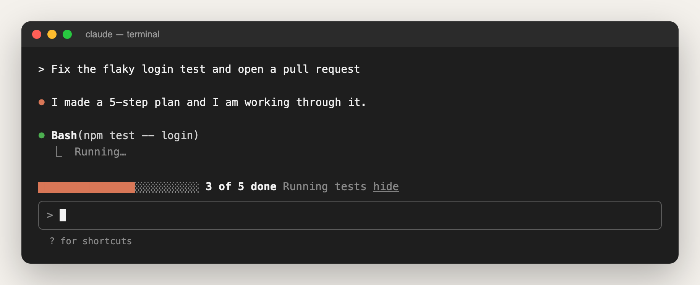
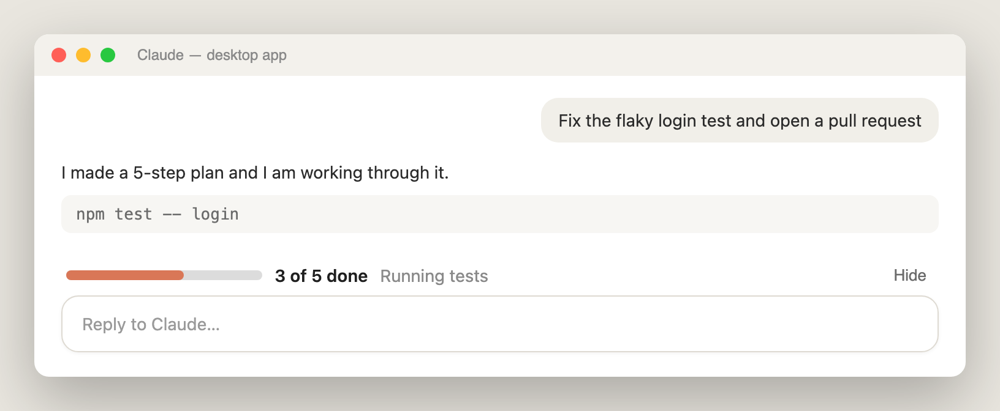
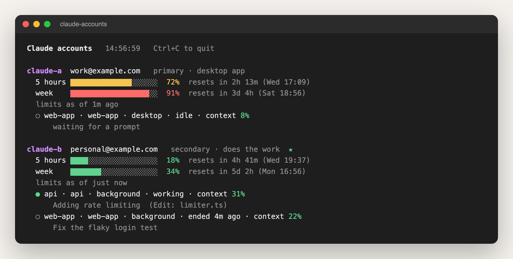

<div align="center">

# 🧰 Claude Tools

**Small, sharp add-ons that make [Claude Code](https://code.claude.com) nicer to live with.**

See where a long job is at a glance. Use several Claude accounts from one chat, and switch between them without losing a word.

[](LICENSE)
[](https://code.claude.com)
[](#-the-tools)
[](#-what-you-need)

[The tools](#-the-tools) · [See them](#-see-them) · [Install](#-install) · [Ask your AI to install](#-or-just-ask-your-ai) · [Add your own](#-add-your-own-tool)

</div>

---

## ✨ The tools

| | Tool | What it does | You want it when |
| :-: | --- | --- | --- |
| 📊 | **[Task progress bar](tools/task-progress)** | Draws a live bar above the prompt box: `███████░░░░ 3 of 5 done  Running tests`. Turns green when the job is done. | Claude works through long, many-step jobs and you want to know how far it has got without scrolling. |
| 🔀 | **[Multi-account](tools/multi-account)** | Lets you talk in one desktop chat while the work runs on whichever of your Claude accounts is active. Switch any time and the chat carries on, with nothing lost. Shows every account's 5-hour and weekly limits live. | You have more than one Claude account, each with a small limit, and you are tired of hitting a wall in the middle of a task. |

Each tool has its own folder with a **README** (for you) and an **AGENT.md** (for your AI agent).

## 👀 See them

> Pictures rendered from each tool's real output, with demo data.

**Task progress bar**, in the terminal and in the desktop app:





**Multi-account**, the `claude-accounts` live view (also inside the app: type `/accounts`):



## 🚀 Install

**1. Get the tools** (one folder, easy to update):

```bash
git clone https://github.com/SouravAggarwal/Claude-Tools ~/.claude-tools
```

**2. Install the ones you want:**

```bash
~/.claude-tools/tools/task-progress/install.sh
```

```bash
~/.claude-tools/tools/multi-account/install.sh
```

**3. Start a new chat.** That's it. Each install script tells you what it changed and what (if anything) is next.

**Update later:**

```bash
git -C ~/.claude-tools pull
```

Then type `/reload-plugins` in any open chat.

<details>
<summary><b>Only want the progress bar, with no download?</b></summary>

```bash
claude plugin marketplace add SouravAggarwal/Claude-Tools
```

```bash
claude plugin install task-progress@claude-tools --scope user
```

```bash
jq '.env.CLAUDE_CODE_ENABLE_TODO_TOOLS = "1"' ~/.claude/settings.json > /tmp/claude-settings.json && mv /tmp/claude-settings.json ~/.claude/settings.json
```

</details>

## 🤖 Or just ask your AI

Paste this into Claude Code or Codex:

> Install the task progress bar from https://github.com/SouravAggarwal/Claude-Tools

or

> Set up multi-account from https://github.com/SouravAggarwal/Claude-Tools

The agent reads [`AGENTS.md`](AGENTS.md), then the tool's own `AGENT.md`, and follows its steps: check what is needed, install, check that it worked, and tell you what changed. Anything only you can do (like signing in to an account) it hands back to you.

## 🧩 What's inside

```text
Claude-Tools/
├── README.md                  ← you are here
├── AGENTS.md                  ← rules for AI agents working in this repository (CLAUDE.md points here)
├── .claude-plugin/
│   └── marketplace.json       ← lets Claude Code install the add-ons from this repository
├── docs/images/               ← the pictures above
└── tools/
    ├── task-progress/         ← 📊 progress bar add-on
    │   ├── README.md          ← for people
    │   ├── AGENT.md           ← for AI agents: exact install steps
    │   ├── install.sh · uninstall.sh
    │   └── hooks/ · tests/
    └── multi-account/         ← 🔀 switch accounts, keep the chat
        ├── README.md · AGENT.md
        ├── install.sh · uninstall.sh
        ├── bin/               ← claude-use, claude-ask, claude-accounts, claude-accounts-add, claude-as
        ├── account-status/    ← the add-on behind the live limits
        └── templates/
```

## ✅ What you need

- **Claude Code 2.1.278 or later.** These tools use Claude Code add-ons ("mods"), which are early access. If one does not load, run `claude update`.
- **`jq`** for both tools, and **`python3`** for multi-account.
- **macOS.** Everything was built and tested on macOS. Linux should work, but it has not been tested yet.
- Multi-account's front desk uses the **Claude desktop app**. Everything else also works in the terminal.

## 🛠 Add your own tool

Have a tool worth sharing? Every tool follows the same simple shape: one folder, a README for people, an AGENT.md for agents, an install and an uninstall script, and tests. [`AGENTS.md`](AGENTS.md) has the full checklist. Your AI agent reads it on its own, so you can just ask it to "add my tool to this repository".

## 📄 License

[MIT](LICENSE). Use it, change it, share it.
