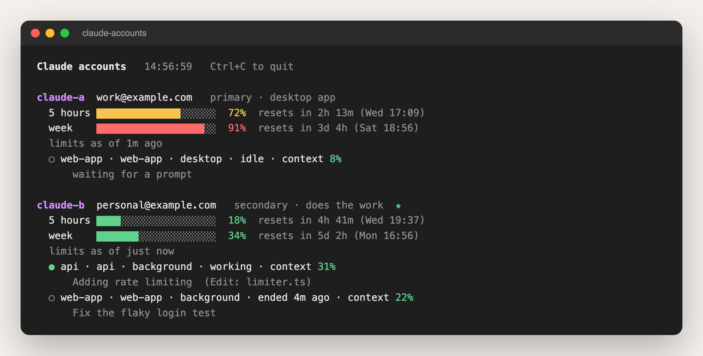

# 📈 Usage Limits Monitor for Claude Code

**Watch your Claude usage limits live**: 5-hour and weekly use with the time each one resets, plus every chat's context window and what it is working on. Works for one account or several. Type `/accounts` to open the panel.



> Picture rendered from the real output, with demo accounts.

## Why you want it

- **No more hitting a wall mid-task.** You see how much of your 5-hour and weekly limits you have used, and when each resets, before you start something big.
- **Every chat in one place.** Each running chat shows its project, how full its context window is, and the step it is on.
- **Two accounts?** If you use more than one Claude account, each chat shows which one it runs on, and the panel shows the limits of each. The [multi-account](../README.md) tool in this repository builds on it to hand work from one account to another.

## How it works

- **What it hooks:** `session.start`, `turn.complete` and `session.end` to write the chat's status; `tool.call` and `prompt.submit`, which it lets through unchanged and only reads (the current step and your last request, shortened); `command.run` for `/accounts`; and `ui.render` / `ui.close` for the panel. It never blocks, changes or adds to a tool call or a prompt.
- It runs inside each chat and only watches. It never changes what Claude does.
- Every 20 seconds, and at each step, it writes one small file for the chat to `~/.claude-accounts/status/`: the account, its latest 5-hour and weekly use (as Claude Code reports it), the context window, the project folder and the current step.
- `/accounts` opens a panel beside the chat that reads those files and refreshes every 5 seconds.
- To name your accounts, it reads `~/.claude-accounts/config.json` if you have one. Without it, the account shows as "unknown" and everything else still works.
- It sends nothing over the internet and runs no other program. Everything stays in those files on your computer.

## Install

```bash
claude plugin marketplace add SouravAggarwal/Claude-Tools
```

```bash
claude plugin install account-status@claude-tools --scope user
```

Then start a new chat and type `/accounts`.

## Use

| You type | You get |
| --- | --- |
| `/accounts` | The panel: each account's 5-hour and weekly limits with reset times, and each chat's project, context and current work |

Limits show after the account's next message, because Claude Code reports them with each reply.

## Remove

```bash
claude plugin uninstall account-status@claude-tools
```

The status files stay. To delete them: `rm -rf ~/.claude-accounts/status`

## Tested

12 automated tests, with stand-ins for the engine and the files: `claude plugin test tools/multi-account/account-status`.

## License

MIT
