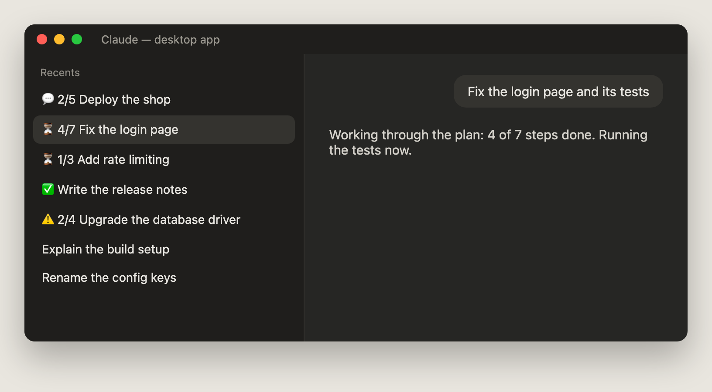
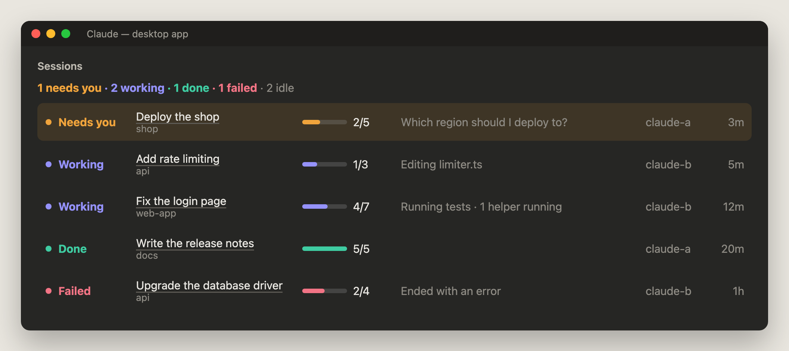

# 🚦 Session status

See which of your Claude sessions are **working**, which **need you**, and which are **done**, without opening each one.

- In the Claude desktop app, each chat's title in the sidebar gets a marker and a step count: `⏳ 4/7 Fix the login page`.
- Type `/sessions` for a board of every session, the ones that need you first.
- No alerts, no sounds, no pop-ups. It only shows.





> Pictures rendered from the add-on's real output (its markers, colours, dots, bars and texts) with demo sessions, in a drawn app window.

## Why you want it

- **Many chats at once.** With five chats running, you see at a glance which one is waiting on a question.
- **Quiet chats that are still busy.** A chat can look idle while its helper agents or background commands run. It stays **working** until they finish.
- **Done means done.** A chat only reads **done** when its whole checklist is complete, not just because Claude paused.

## The states

One rule decides the state. It checks these in order and takes the first that fits.

| Marker | State | When |
| --- | --- | --- |
| ⚠️ | **Failed** | The last turn ended with an error, or Claude refused. |
| 💬 | **Needs you** | Claude asked you a question (AskUserQuestion), a plan waits for your OK (ExitPlanMode), the desktop app's `wrap_up` ended the turn with a question, or the turn stopped with checklist steps left. |
| ⏳ | **Working** | A turn is running, or helper agents or background commands (Agent, Bash in the background, Monitor, Workflow) have not finished. |
| ✅ | **Done** | The turn ended normally, nothing is still running, and every checklist step is complete (or `wrap_up` ran with no question). |
| (none) | **Idle** | You stopped it, or nothing has happened yet. |

- A **turn** is one stretch of Claude working, from your message to its answer.
- The **step count** (`4/7`) comes from Claude's checklist: the desktop app's own plan tool (`update_plan` and `wrap_up`), or the task tools (`TaskCreate`, `TaskUpdate`, `TaskList`, `TaskGet`, `TodoWrite`). A done chat shows no count.
- Helper agents count only toward **working**. Their own errors never make the chat **failed**.

## How it works

- An add-on watches the session's turns and tool calls. It never changes them.
- Each session writes one small file to `~/.claude-session-status/`: its state, steps, helpers, title, folder, and account. It works without any other tool installed.
- If [multi-account](../multi-account) reports the same session, the board shows that session's account.
- **Sidebar marker (desktop app only):** the add-on renames the chat through the app's own session server (`ccd_session_mgmt`). It keeps your title and only swaps the marker in front. It renames only when the marker or the count changes. It waits for the app to name a new chat first. In the terminal it does nothing, and if the app ever refuses a rename, it stops renaming that chat.
- **A chat you rename keeps your name exactly** and shows no marker. The app would ask you to approve every rename of a name you gave, so the add-on never renames it. To know who named the chat, it reads one field (`titleSource`) from the app's own record of the chat, and nothing else. If it cannot read that record, it only renames a title that is exactly the one it wrote last.
- **Board:** `/sessions` opens a pane beside the chat. It refreshes every 3 seconds. Click a chat's title to open that chat in the desktop app (macOS `open`).

## Install

From a clone of this repository (see the [main README](../../README.md#-install)):

```bash
~/.claude-tools/tools/session-status/install.sh
```

Or with no download at all:

```bash
claude plugin marketplace add SouravAggarwal/Claude-Tools
```

```bash
claude plugin install session-status@claude-tools --scope user
```

Then start a new chat. Or ask your AI agent: *"Install session-status from https://github.com/SouravAggarwal/Claude-Tools"* (it follows [AGENT.md](AGENT.md)).

## Use

| You do | You get |
| --- | --- |
| Nothing | Each desktop chat's sidebar title shows its marker and step count |
| Type `/sessions` | The board: needs you, then working, done, failed; idle ones as a count |
| Click a title on the board | That chat opens in the desktop app |

The board's columns: state, title and project folder, steps, what it is on (or waiting for, and how many helpers are running), account, and time in this state.

## Options

The installer sets `A` the first time and never changes your pick after that. Pick the markers in `/config` (the **Sidebar markers** row of session-status), or in `~/.claude/settings.json` under `pluginConfigs`:

| Set | Working | Needs you | Done | Failed |
| --- | --- | --- | --- | --- |
| `A` (default) | ⏳ | 💬 | ✅ | ⚠️ |
| `B` | 🔹 | 🔸 | ✔️ | ❗ |
| `C` | 🔵 | 🟡 | 🟢 | 🔴 |
| `off` | no marker; an old one is taken away | | | |

**A chat you rename** keeps your name exactly and shows no marker. The `/sessions` board still shows its state.

- Markers come back only if Claude renames the chat later.
- A marker you keep inside your own name (say `⏳ 2/5 city url`) stays as plain text. It is not updated.

## Remove

```bash
~/.claude-tools/tools/session-status/uninstall.sh
```

- A chat's title keeps its last marker until you rename it.
- The status files stay. To delete them: `rm -rf ~/.claude-session-status`

## Update or reload

```bash
git -C ~/.claude-tools pull
```

Then type `/reload-plugins` in an open chat, or start a new one.

## Troubleshooting

| Problem | Fix |
| --- | --- |
| A chat you renamed shows no marker | That is on purpose: your name stays as you wrote it. See its state on the `/sessions` board. |
| No marker in the sidebar | Markers only work in the desktop app. Check that the option is not `off`. A brand-new chat gets its marker once the app has named it. |
| A chat says **working** but looks quiet | Something it started is still running (a helper agent or a background command). The board says how many. |
| A row says "Not running" | That session stopped sending updates for over 2 minutes while working: its process has gone. |
| Nothing at all | Run `claude -p "hi" --debug-file /tmp/claude-debug.log`, then `grep session-status /tmp/claude-debug.log`. Add-ons need Claude Code 2.1.278 or later (`claude update`). |

## Tested

In a real desktop app chat on macOS (2026-10-29):

- The status file in `~/.claude-session-status/` updates live: state, steps, current step, project, account.
- The sidebar marker works: the title went `⏳ 0/4 …` → `⏳ 1/4 …` as steps finished, and started again at `⏳ 1/3 …` for a new checklist. No approval card appeared, because the app had named that chat.
- A background command counted as 1 helper and kept the chat **working**. It dropped to 0 once its finish notice arrived. A notice that lands while Claude is replying is counted at the chat's next step.
- `/sessions` opened the board, and it looked right.

In that test, renaming a chat by hand made the app ask to approve each later rename. Version 1.0.2 fixes this by never renaming a chat you named; that fix has automated tests, but has **not yet been tried in the app**. Also not yet tried: opening a chat by clicking its title on the board.

Also 45 automated tests, with stand-ins for the engine, the files, the app's session server and `open`, on the terminal and desktop surfaces: `claude plugin test tools/session-status`.

## Files

| File | What it is |
| --- | --- |
| `hooks/register.tsx` | Watches the session, writes its status file, marks the title, draws the board |
| `hooks/status.ts` | The state rule, the markers, and how the board reads the files |
| `hooks/plan.ts` | Counts the steps. The same file as `tools/task-progress/hooks/plan.ts` (see below) |
| `tests/` | 45 tests |
| `install.sh`, `uninstall.sh` | Add and remove it |

`hooks/plan.ts` is a copy, not an import. Each add-on is installed as its own folder, so one cannot import a file from another. Keep the two copies the same: `diff tools/task-progress/hooks/plan.ts tools/session-status/hooks/plan.ts` must print nothing.
