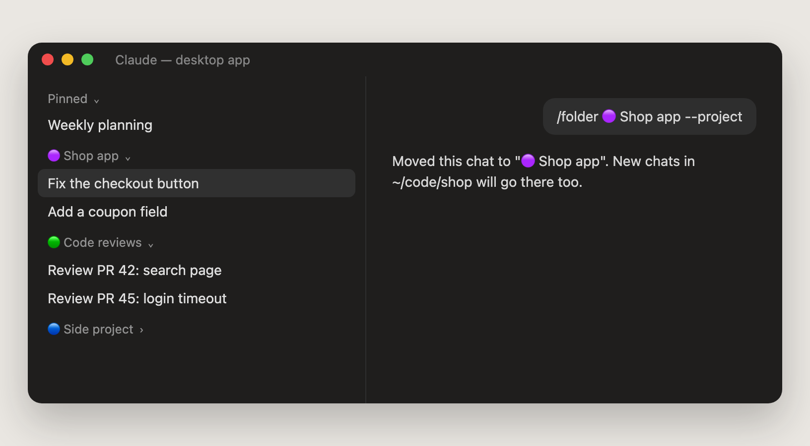

# 🗂️ Sidebar folders

Sort the chats in the Claude desktop app's sidebar into **folders with your own names**, and keep them there.

- New chats file themselves: by the project folder they run in, or by a word in their title.
- A chat Claude starts from another chat goes into the same folder as its parent.
- Type `/folder <name>` to move a chat by hand. The folder is made if it is new.
- A chat stays in its folder until you move it. The add-on never moves a chat twice.



## Why you want it

- **The sidebar groups by repository by default.** That is rarely how you think about your work. With folders you choose the groups: "Code reviews", "Bug fixes", "Side project".
- **No more dragging.** Say once which project or which words belong to a folder, and every new chat lands there by itself.
- **Families stay together.** Chats Claude starts for you (forks and side tasks) go into the same folder as the chat that started them.

## How it works

- The desktop app already has folders (it calls them custom groups). This add-on only files chats into them, through the app's own sidebar server (`ccd_sidebar`). It does not draw anything itself.
- **When:** as a chat starts, and after each of its first few turns (the app gives a chat its title during its first turn). As soon as a rule matches, the chat is filed, and the add-on never looks at it again.
- **The order it checks:**
  1. The chat is already in a folder (you put it there, or it was resumed): it stays.
  2. Claude started it from another chat that is in a folder: same folder.
  3. Your rules, top to bottom: the first rule that matches wins.
  4. Nothing matched after 3 turns: it stays where the app put it.
- **Take a chat out** with `/folder none`. Rules never move it again.
- It keeps one tiny file per filed chat in `~/.claude/sidebar-folders/filed/`, so a resumed chat is not filed again.
- In the terminal there is no sidebar, so it does nothing there.

## Rules

Rules live in `~/.claude/sidebar-folders.json`. The easiest way to make one is from a chat: `/folder Code reviews --project` moves this chat and sends every new chat from this project folder there too.

You can also write the file yourself (or ask Claude to):

```json
{
  "followParent": true,
  "rules": [
    { "name": "Code reviews", "titles": ["review", "PR #"] },
    { "name": "Bug fixes", "titles": ["fix", "bug"] },
    { "name": "Shop app", "projects": ["~/code/shop"] }
  ]
}
```

| Field | What it does |
| --- | --- |
| `name` | The folder's name in the sidebar. It is made the first time a chat goes in. Names match any case, and a name without the emoji or symbols in front still finds its folder ("Shop app" finds "🟣 Shop app"). |
| `projects` | Project folders. A chat whose folder is one of these, or inside one, matches. `~` is your home folder. |
| `titles` | Words. A chat whose title holds one of them (any case) matches. |
| `id` | Added by the add-on the first time the rule finds its folder. It keeps the rule on that folder after you rename the folder in the sidebar. Delete it to point the rule at a folder by `name` again. |
| `followParent` | `true` (the default): a chat Claude started goes into its parent's folder first. `false` turns that off. |

## Install

From a clone of this repository (see the [main README](../../README.md#-install)):

```bash
~/.claude-tools/tools/sidebar-folders/install.sh
```

Or with no download at all:

```bash
claude plugin marketplace add SouravAggarwal/Claude-Tools
```

```bash
claude plugin install sidebar-folders@claude-tools --scope user
```

Then start a new chat in the desktop app. Or ask your AI agent: *"Install sidebar-folders from https://github.com/SouravAggarwal/Claude-Tools"* (it follows [AGENT.md](AGENT.md)).

## Use

| You type | You get |
| --- | --- |
| `/folder` | Which folder this chat is in, and every folder with its number of chats |
| `/folder Code reviews` | This chat moves to "Code reviews" (made if new) |
| `/folder Code reviews --project` | The same, and every new chat from this project folder goes there too |
| `/folder none` | This chat leaves its folder, and rules never move it again |

You can still drag chats between folders, rename and delete folders in the sidebar itself.

## What it cannot do

- **Pinned** is the app's own section. It cannot be renamed or hold folders. Moving a pinned chat into a folder unpins it (the app does that).
- No folders inside folders. The app has one level.

## Remove

```bash
~/.claude-tools/tools/sidebar-folders/uninstall.sh
```

- Your folders and the chats in them stay in the sidebar.
- Your rules stay. To delete them: `rm -rf ~/.claude/sidebar-folders.json ~/.claude/sidebar-folders`

## Update

```bash
git -C ~/.claude-tools pull
```

```bash
~/.claude-tools/tools/sidebar-folders/install.sh
```

Then start a new chat. Claude runs a saved copy of the add-on; the install script brings that copy up to date, so a pull alone changes nothing.

**1.1.0:** renaming a folder in the sidebar no longer breaks its rule (before, the next new chat made a second folder with the old name). A rule saves its folder's `id`, and a name with emoji in front is found without them.

## Troubleshooting

| Problem | Fix |
| --- | --- |
| A new chat did not move | Rules only file a chat once, and never one that is already in a folder. Check the rule's spelling with `/folder`, and that the chat's folder is inside the rule's `projects`. |
| `/folder` says it works only in the desktop app | That chat runs in a terminal, which has no sidebar. |
| A chat I took out went back in | It cannot: `/folder none` marks it as decided. If you dragged it out instead, a later rule may still file it in its first 3 turns. |
| Nothing at all | Run `claude -p "hi" --debug-file /tmp/claude-debug.log`, then `grep sidebar-folders /tmp/claude-debug.log`. Add-ons need Claude Code 2.1.278 or later (`claude update`). |

## Tested

- 25 automated tests, with stand-ins for the engine, the files and the app's session and sidebar servers: `claude plugin test tools/sidebar-folders`. They cover each rule kind, rule order, following the parent, a chat already in a folder, a resumed chat, a chat the app started ahead of time in a spare folder, a folder renamed in the sidebar, the app not answering at first, the terminal, and every form of `/folder`.
- The answers the app's servers give (a chat's details, the folder list, "No custom sidebar groups.") were checked against the real desktop app on macOS (2026-11-11).
- **Not yet tried end to end in the app:** a new chat filing itself, and `/folder` typed in a chat.

## Files

| File | What it is |
| --- | --- |
| `hooks/register.ts` | Files the chat when it starts and after its first turns; answers `/folder` |
| `hooks/folders.ts` | The rules file, which folder a chat belongs in, and reading the app's answers |
| `tests/` | 25 tests |
| `install.sh`, `uninstall.sh` | Add and remove it |
